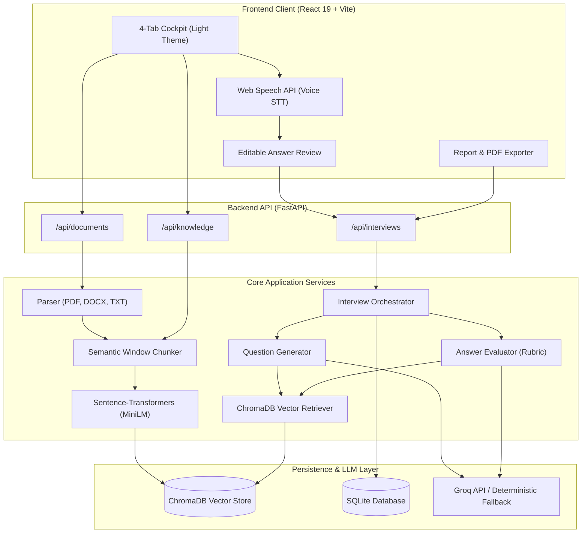
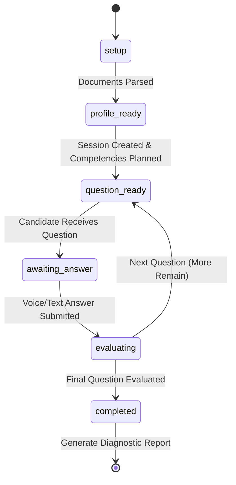

# InterviewPilot 🎙️

> **AI-Powered Adaptive Technical Interview Platform with Evidence-Grounded Rubric Scoring**

InterviewPilot is an end-to-end technical interview preparation and candidate evaluation system. By bridging parsed resume credentials with job specifications, InterviewPilot generates personalized, role-specific questions, accepts responses through native real-time voice speech-to-text or keyboard input, and produces deterministic, 4-dimension rubric evaluations grounded in an inspectable vector knowledge base.

---

## Badges

[](https://github.com)
[](https://github.com)
[](https://www.python.org/)
[](https://fastapi.tiangolo.com/)
[](https://react.dev/)
[](https://vitejs.dev/)
[-blueviolet.svg?style=flat-square)](https://github.com/oxc-project/oxc)
[](https://www.trychroma.com/)
[](LICENSE)

---

## Features

- **📄 Document Parsing & Profile Extraction:** Multi-format parser for resumes and job specifications (`.pdf`, `.docx`, `.txt`). Automatically extracts candidate competencies, years of experience, and role requirements with heuristic and LLM extraction.
- **🧠 Inspectable RAG Knowledge Base:** Persistent local ChromaDB vector store powered by `sentence-transformers/all-MiniLM-L6-v2`. Supports shared and role-specific technical documents with transparent chunk citations and similarity scoring.
- **🎯 Dynamic Question Generation & Orchestration:** Plans competency coverage, adapts difficulty dynamically, and grounds interview scenarios in candidate experience and verified reference documents without source hallucination.
- **⚖️ 4-Dimension Rubric Evaluation:** Computes an objective 0–100 weighted score:
  $$\text{Composite Score} = \frac{\text{Correctness} \times 30 + \text{Completeness} \times 30 + \text{Relevance} \times 20 + \text{Clarity} \times 20}{5}$$
  Strictly validates citations against real ChromaDB chunks, rejecting hallucinated IDs and flagging insufficient evidence safely.
- **🎙️ Real-Time Voice Speech-to-Text (STT):** Browser-native speech recognition with permission detection, live listening indicators, editable pre-submission review, and graceful text fallback for unsupported environments.
- **📊 Comprehensive Report & Session History:** Generates post-interview diagnostic reports featuring hiring recommendations (`Strong Hire`, `Hire`, `Lean Hire`, `Needs Improvement`), dimension breakdowns, coaching feedback, and citation audit tables. Past sessions are persisted in SQLite and can be resumed, reviewed, or deleted.
- **🌿 Fresh Organic Light Theme:** High-contrast, accessibility-focused light interface using a custom 5-color palette: `#1D1E18` (Carbon Black), `#6B8F71` (Dusty Olive), `#AAD2BA` (Celadon), `#D9FFF5` (Frozen Water), and `#B9F5D8` (Celadon Mint).
- **⚡ 100% Offline Testable:** Operates with zero paid API keys using its built-in deterministic fallback engine for all generation, RAG, and evaluation tasks. Optional live Groq API support can be toggled via environment variables.

---

## Tech Stack / Built With

### Frontend
- **Framework:** [React 19](https://react.dev/)
- **Build Tool:** [Vite](https://vitejs.dev/)
- **Voice Recognition:** Web Speech API (`SpeechRecognition` / `webkitSpeechRecognition`)
- **Styling:** Custom CSS Design Tokens & Glassmorphic Components
- **Linter:** [Oxlint](https://oxc-project.github.io/oxc/) (Rust-based high-speed linter)

### Backend
- **Framework:** [FastAPI](https://fastapi.tiangolo.com/) + [Uvicorn](https://www.uvicorn.org/) (Async REST API)
- **Data Validation:** [Pydantic v2](https://docs.pydantic.dev/) Settings & Data Models
- **Vector Database:** [ChromaDB](https://www.trychroma.com/) (Local persistent storage)
- **Embeddings:** [Sentence-Transformers](https://sbert.net/) (`all-MiniLM-L6-v2`, runs locally)
- **Relational Storage:** SQLite (Local interview sessions, questions, evaluations)
- **Document Parsers:** [PyMuPDF (fitz)](https://pymupdf.readthedocs.io/), [python-docx](https://python-docx.readthedocs.io/)
- **LLM Client:** [Groq API](https://groq.com/) (`llama-3.3-70b-versatile` / `llama-3.1-8b-instant`) with automatic deterministic fallback engine
- **Test Harness:** [Pytest](https://docs.pytest.org/) (76 automated tests)

---

## Architecture / System Design

### High-Level Architecture



### Interview Session State Machine



---

## Prerequisites

Before running InterviewPilot locally, verify you have the following installed:

1. **Python:** Version `3.10` or higher (tested on Python `3.13.13`).
2. **Node.js:** Version `18.0` or higher (tested on Node `v22.14.0` with `npm 10.9.2`).
3. **Git**
4. **Microphone (Optional):** Required only if testing browser voice speech-to-text; text-based typing is always enabled.
5. **Groq API Key (Optional):** If you wish to use live cloud LLM inference instead of the built-in deterministic fallback engine.

---

## Installation Guide

### 1. Clone the Repository

```bash
git clone https://github.com/your-username/interviewpilot.git
cd interviewpilot
```

### 2. Backend Setup

Open a terminal in the project root:

```powershell
# Navigate into backend directory
cd backend

# Create Python virtual environment
python -m venv .venv

# Activate virtual environment
# Windows PowerShell:
.\.venv\Scripts\Activate.ps1
# Windows CMD:
.\.venv\Scripts\activate.bat
# Linux / macOS:
source .venv/bin/activate

# Install dependencies
pip install -r requirements.txt

# Start the FastAPI server on port 8000
python -m uvicorn app.main:app --reload --host 127.0.0.1 --port 8000
```

> **Verify Backend:**
> - Health Check: [http://127.0.0.1:8000/api/health](http://127.0.0.1:8000/api/health)
> - Interactive OpenAPI Swagger UI: [http://127.0.0.1:8000/docs](http://127.0.0.1:8000/docs)

### 3. Frontend Setup

Open a second terminal window:

```powershell
# Navigate into frontend directory
cd frontend

# Install Node dependencies
npm install

# Start Vite development server
npm run dev
```

> **Open Application:** Navigate to **[http://localhost:5173](http://localhost:5173)** in your browser.

---

## Usage Examples

### 1. Seed Default Knowledge Base (CLI / cURL)

Seed system design, concurrency, and distributed systems reference chunks into ChromaDB:

```bash
curl -X POST "http://127.0.0.1:8000/api/knowledge/seed-defaults"
```

*Response:*
```json
{
  "message": "Seeded 3 reference documents successfully.",
  "documents": [
    {"source_name": "System Design & Microservices Architecture", "chunk_count": 8},
    {"source_name": "Distributed Systems & Concurrency", "chunk_count": 7},
    {"source_name": "Python Concurrency & AsyncIO Internals", "chunk_count": 6}
  ]
}
```

### 2. Ingest Custom Knowledge Base Document

```bash
curl -X POST "http://127.0.0.1:8000/api/knowledge/ingest" \
  -H "Content-Type: application/json" \
  -d '{
    "source_name": "Database Caching Standards",
    "scope": "shared",
    "topic": "Caching",
    "content": "Redis cache-aside pattern requires distributed locking to prevent cache stampedes under high concurrency."
  }'
```

### 3. Semantic Vector Search

```bash
curl -X POST "http://127.0.0.1:8000/api/knowledge/search" \
  -H "Content-Type: application/json" \
  -d '{
    "query": "How do you prevent cache stampedes?",
    "top_k": 3,
    "scope": "shared"
  }'
```

### 4. Create an Interview Session

```bash
curl -X POST "http://127.0.0.1:8000/api/interviews" \
  -H "Content-Type: application/json" \
  -d '{
    "candidate_profile": {
      "full_name": "Alex River",
      "title": "Senior Backend Engineer",
      "years_of_experience": 5,
      "primary_competencies": ["FastAPI", "Distributed Systems"]
    },
    "job_requirements": {
      "role_title": "Senior Backend Engineer",
      "target_seniority": "Senior",
      "core_competencies": ["FastAPI", "Distributed Systems"]
    },
    "total_questions": 3
  }'
```

### 5. Submit Answer for Rubric Evaluation

```bash
curl -X POST "http://127.0.0.1:8000/api/interviews/{session_id}/questions/{question_id}/answer" \
  -H "Content-Type: application/json" \
  -d '{
    "answer_text": "In FastAPI, coroutines run on the main asyncio loop. Blocking sync calls must be offloaded to threadpools with run_in_threadpool."
  }'
```

*Evaluation Response:*
```json
{
  "evaluation": {
    "weighted_score": 86.0,
    "dimension_scores": {
      "correctness": 5,
      "completeness": 4,
      "relevance": 5,
      "clarity": 4
    },
    "strengths": ["Accurately identifies event loop thread blocking in FastAPI"],
    "missing_concepts": [],
    "actionable_feedback": "Elaborate on SQLAlchemy connection pool cleanup.",
    "citations": [
      {
        "chunk_id": "chunk_py_async_1",
        "source_name": "Python Concurrency & AsyncIO Internals",
        "topic": "Event Loop",
        "excerpt": "Calling synchronous blocking functions inside async def blocks the entire event loop..."
      }
    ],
    "evaluation_status": "completed"
  }
}
```

### 6. Interactive UI Walkthrough
1. **Document Setup:** Upload or load sample resume and job spec, then click **"Parse & Analyze Documents"**.
2. **Knowledge Base:** Click **"Seed Default Knowledge Base"** and test query search.
3. **Adaptive Interview:** Click **"Start Interview Session"**.
4. **Voice Answer:** Click **"🎙️ Record Answer with Voice"**, speak your response, review/edit text in the box, and click **"Evaluate Answer"**.
5. **View Final Report:** Review composite score, radar dimensions, verified citations, and click **"Print / Export PDF"**.

---

## Configuration

Application settings are managed through `backend/app/config.py` using `pydantic-settings`. Environment variables can be provided in `backend/.env`.

| Variable | Type | Default | Description |
|---|---|---|---|
| `GROQ_API_KEY` | `string` | `""` | Optional Groq API key for cloud LLM inference. If blank, offline fallback is used. |
| `APP_NAME` | `string` | `"InterviewPilot API"` | Application display name. |
| `APP_VERSION` | `string` | `"0.1.0"` | Current API version. |
| `ENVIRONMENT` | `string` | `"development"` | Active environment (`development` / `production`). |
| `HOST` | `string` | `"127.0.0.1"` | Server host binding. |
| `PORT` | `integer` | `8000` | Server listening port. |
| `CORS_ORIGINS` | `string` | `"http://localhost:5173,http://127.0.0.1:5173"` | Comma-separated list of allowed CORS origins. |
| `DATABASE_URL` | `string` | `"sqlite:///./interviewpilot.db"` | SQLAlchemy SQLite connection string. |
| `CHROMA_PERSIST_DIRECTORY` | `string` | `"./chroma_db"` | Local directory path for ChromaDB vector embeddings. |
| `USE_MOCK_EMBEDDINGS` | `boolean` | `false` | When `true`, uses lightweight deterministic hashing for ultra-fast CI testing. |

### Environment Security & Hygiene
- Real `.env` files, SQLite databases (`*.db`), ChromaDB storage directories (`chroma_db/`), and build outputs are strictly excluded via [`.gitignore`](file:///c:/Projects/generative_resume/.gitignore).
- A safe placeholder template is provided at [`backend/.env.example`](file:///c:/Projects/generative_resume/backend/.env.example). Never commit real API keys to version control.

---

## Running Tests

### Backend Automated Test Suite (76 tests)
Run the complete Pytest suite from the `backend/` directory:

```powershell
cd backend
.\.venv\Scripts\pytest.exe -v
```

Expected result:
```text
======================= 76 passed, 13 warnings in 17.68s =======================
```

#### Test Suite Breakdown:
- **`test_parser.py`**: Multi-format parsing, corrupt documents, legacy format rejection, and file size boundary tests.
- **`test_chunker.py`**: Semantic sliding-window chunking, token counts, and overlap calculations.
- **`test_retriever.py`**: ChromaDB vector indexing, semantic search, scope filtering, and source ID provenance.
- **`test_question_generator.py`**: Ordered competency plans, difficulty adaptation, context grounding, and deduplication.
- **`test_score_formula.py`**: Boundary values (0 and 100), weighted rubric ratios (30/30/20/20), and out-of-bounds error handling.
- **`test_answer_evaluator.py`**: Rubric scoring, rejection of hallucinated citation IDs, and insufficient evidence handling.
- **`test_orchestrator.py` & `test_report.py`**: State machine transitions, persistence across restarts, composite score calculation, and session history management.
- **`test_hardening.py`**: Prompt-injection defense, zero secret exposure across endpoints, input sanitization of extreme payloads, and cascading SQLite deletion.

### Frontend Linter & Build Verification
Run Oxlint and Vite production compilation from the `frontend/` directory:

```powershell
cd frontend

# Run Oxlint code quality check
npm run lint

# Run Vite production bundle build
npm run build
```

Expected result:
```text
Found 0 warnings and 0 errors.
✓ built in ~200ms
```

---

## Phase Audit Trail

All phases outlined in [`MASTER_PLAN.md`](file:///c:/Projects/generative_resume/MASTER_PLAN.md) have been implemented, verified, and explicitly approved:

- [x] **Phase 0 — Workspace inspection & project setup:** APPROVED
- [x] **Phase 1 — Document parsing & profile extraction:** APPROVED
- [x] **Phase 2 — Knowledge base & inspectable RAG:** APPROVED
- [x] **Phase 3 — Question generation & state machine:** APPROVED
- [x] **Phase 4 — Answer evaluation & scoring rubric:** APPROVED
- [x] **Phase 5 — Complete text interview & report UI:** APPROVED
- [x] **Phase 6 — Voice input, hardening, & portfolio delivery:** APPROVED

Detailed logs and execution evidence are maintained in [`PHASE_LOG.md`](file:///c:/Projects/generative_resume/PHASE_LOG.md).

---

## License

This project is licensed under the MIT License — see the [LICENSE](LICENSE) file for details.
